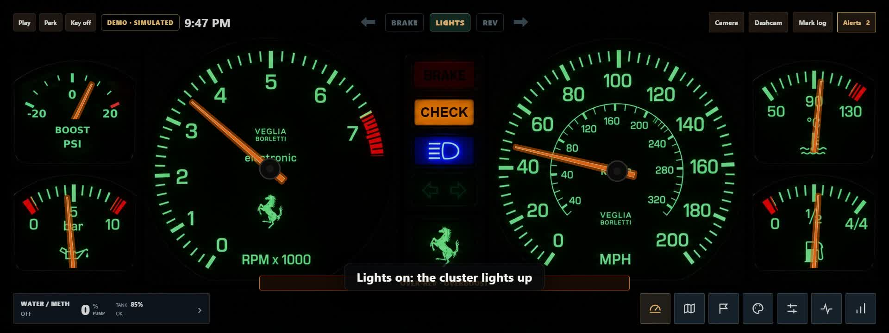
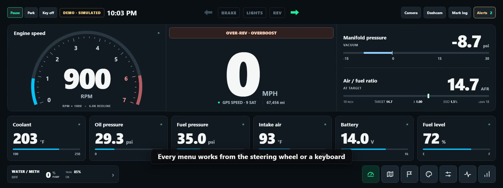
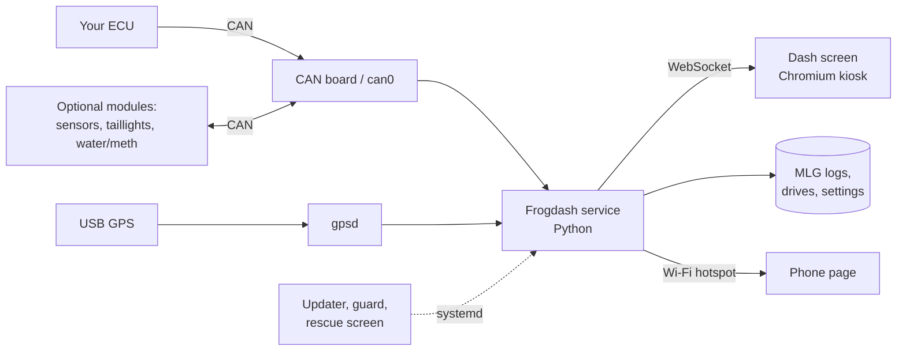

<div align="center">

# Frogdash

**An open-source, customizable digital dash for cars with an aftermarket ECU.**
A Raspberry Pi and a screen read your engine over CAN: gauges you can restyle, alerts,
data logging, GPS, maps, lap timing and cameras, all running in the car with no cloud.

[](https://github.com/averyizatt/frogdash/actions/workflows/test.yml)
[](https://averyizatt.github.io/frogdash/)

[](LICENSE)

**[Try the live preview](https://averyizatt.github.io/frogdash/)** · [Documentation](docs/README.md) · [Install guide](#install-guide) · [Changelog](CHANGELOG.md)

</div>

| Looks and photo clusters (72 s) | Menus, shortcuts and features (1:45) |
|---|---|
| [](docs/media/frogdash-tour.mp4) | [](docs/media/frogdash-features.mp4) |

<sub>Recorded from the simulated preview: the readings are demo data. Click a picture to play the video.</sub>

## What it is

Frogdash turns a Raspberry Pi and a screen into an instrument cluster. It listens to your
ECU on the CAN bus and shows what the engine is doing. It warns before something breaks,
records every drive in MegaLogViewer format, and adds GPS speed, an offline map, lap timing
and cameras. Everything runs on the Pi: no phone app, no account, no internet needed to
drive.

It is made to live in a car. It starts in seconds and survives the key going off mid-write.
It updates itself with a trial start and an automatic rollback. It can be set up, checked
and recovered from the screen, steering-wheel buttons or a phone, without a keyboard.

What a car has is set in one place, the [system profile](docs/presets.md): the ECU, CAN
board, GPS, cameras, modules, power, time zone. So the same code runs in any build.
Frogdash was developed in a turbocharged Foxbody Mustang, where it has run since 2026: see
[the reference build](#the-reference-build-a-turbo-foxbody) for exactly what is in it.

## What it works with

| | Works today | On the way |
|---|---|---|
| **ECU** | **MegaSquirt / MicroSquirt** (MS2/Extra dash and realtime broadcasts), in a car. **Haltech** Elite/Nexus, **Holley** Terminator X/HP/Dominator and Sniper, **AEM Infinity**, **FuelTech**, **rusEFI**, **MaxxECU**, **ECUMaster EMU Black / PRO** and **Speeduino**, each written from the manufacturer's own documents and tested with simulated frames; not yet in a car. | Link, Emtron and Syvecs, each once its published CAN format is in. Generic **OBD-II** for stock ECUs. Your own CAN layout, described on the dash. [ECU support](docs/ecu-support.md) |
| **Tuning software** | **TunerStudio** runs on the dash itself, over the gauges (MegaSquirt; rusEFI and Speeduino use it too, untested from the Pi). MaxxECU and ECUMaster software is Windows-only: tune from a laptop while the dash keeps reading. | For ECUs whose software is Windows-only (Holley EFI, AEM, Haltech NSP, Link PCLink…), you tune from a laptop as usual; the dash keeps reading the CAN bus meanwhile and says how to connect. |
| **CAN board** | Any MCP2515 board: the Waveshare RS485 CAN HAT (recommended) or the common blue modules | |
| **GPS** | USB receivers through gpsd (u-blox tested), or GPS sent on the CAN bus | |
| **Screen** | Any HDMI screen; made for 12.3-inch 1920 × 720 bar displays, other sizes get their own layout. Touch optional. | |
| **Turn signals, brake, fuel level…** | From a device on the CAN bus (see [Car signals](#car-signals)) | Wired straight to the Pi: inputs and a fuel sender board |
| **Power** | A 5 V supply on the ignition; a PiSugar 3 Plus for clean shutdowns | |

## Features

### Gauges you can make your own
- **Live instruments:** tachometer, speed, boost/vacuum, AFR against the ECU's target,
  coolant, oil and fuel pressure, intake air, battery and fuel level. Each has its own
  live / stale / fault / no-signal state, so a dead sensor never looks like a reading.
- **28 looks in five collections:** signature, track and touring, retro and future, cyber
  (neon HUD) and photo clusters. Two dozen backgrounds, a colour studio, numeral
  typefaces, panel shapes, glow, transparency, and your own images and splash screens.
- **Photo clusters:** real gauge faces with needles measured to the printed marks and every
  dial wired to a reading, each with a day and a night picture. With the lights on, the
  cluster lights up and the needles glow.
- **Street, Tuning and Track layouts** that keep their own gauge choices.
- [UI design](docs/ui-design.md) · [Race and appearance](docs/race-and-appearance.md)

### Alerts that say what went wrong
- **26 alerts** across oil, temperatures, boost, AFR, fuel, knock, ignition, electrics,
  add-on modules and the Pi itself. Each has its own switch, threshold and delay, and a
  plain explanation of what it watches and what to check.
- Shown on the dash (and on photo clusters as a CHECK lamp), with optional chimes,
  latched until acknowledged and saved in the drive's record.
- [Driving tools and alerts](docs/driving-tools.md) · [Screen audio](docs/screen-audio.md)

### Logging, review and tuning
- **MegaLogViewer logs:** genuine `.mlg` files at 20 Hz, rotated and kept within a budget,
  recording with the screen closed.
- **Log viewer on the dash:** Graph, Scatter, Table, Data, Track and Summary views of any
  log, with a cursor showing every channel, zoom, bookmarks and calculated fields.
- **Drive review:** every drive with synchronised graphs, bookmarks (press **B**) and faults;
  a last-drive summary.
- **TunerStudio on the dash**, installed from the Tune tab when wanted.
- **CAN tools:** a DBC file for SavvyCAN and cantools, raw CAN capture, a live signal list.
- [Data logging](docs/data-logging.md) · [TunerStudio](docs/tunerstudio.md) ·
  [SavvyCAN and DBC](docs/savvycan.md)

### Driving
- **Trips and fuel economy:** Trip A/B, MPG and range from calibrated injector data.
- **Offline street map** centred on the GPS, heading up or north up. Make the map of your
  own area from OpenStreetMap with one command ([Map](docs/map.md)).
- **Race timer:** 0–60, eighth and quarter mile, automatic or manual GPS laps, saved sessions.
- **Cameras:** a Pi reverse camera with guide lines, and a Wi-Fi dash cam's live front and
  rear view.
- [Trips and fuel](docs/trip-and-fuel.md) · [Reverse camera](docs/reverse-camera.md) ·
  [Dash cam](docs/dashcam.md)

### Optional modules on the CAN bus
Open-source ESP32 boards from this project, each in its own repository. The dash controls
them and installs their firmware over CAN.
- **[Water/methanol injection](https://github.com/averyizatt/DIYWaterMethInjection):** arm,
  pump test, progressive flow by boost, failsafes, a black box of its last seconds.
- **Knock monitor:** live knock energy, events and the sensor's spectrum.
- **[Taillights](https://github.com/averyizatt/CustomTaillights):** shows, styles, colours
  and timing for LED taillights, mirrored on screen.
- **[Sensor gateway](https://github.com/averyizatt/DIYComfortControlModule):** fuel level,
  vehicle speed, steering-wheel buttons and interior lights.
- [Controls](docs/controls.md) · [Water/meth](docs/water-meth.md) · [Knock](docs/knock.md) ·
  [Taillights](docs/taillights.md) · [Firmware updates](docs/firmware-updates.md)

### Phone, Wi-Fi and staying up
- With the engine off, download logs, see faults, run the system check and update the dash
  from a phone page on the dash's own Wi-Fi, signed in with a code shown on the dash.
- Diagnostics and drives can upload to your own GitHub repository.
- **Updates from the dash:** each new version is started on the side before it is used, and
  undone automatically if it does not come up.
- **Recovery without a keyboard:** a watchdog, a guard that puts back the last version that
  ran, and a rescue screen.
- [Wi-Fi access](docs/wifi-access.md) · [Log uploads](docs/log-uploads.md) ·
  [Reliability](docs/reliability.md) · [Power](docs/pisugar-power.md)

## Controls and shortcuts

Everything works from five steering-wheel buttons, a touch screen or a keyboard.

| Wheel | Key | Does |
|---|---|---|
| Up / Down / Left / Right | Arrow keys (or W / S / D) | Move between items and tabs |
| ON | Enter, E or Space | Select; edit a value |
| Hold ON (0.8 s) | Hold Enter | Quick dock with every destination |
| OFF | A or Esc | Back |
| Hold OFF (1.5 s) / hold ON (3 s) | Hold A | Close every menu |
| | M | Controls |
| | K | Knock monitor |
| | B | Bookmark this moment in the log |

[Steering-wheel navigation](docs/steering-wheel.md)

## Car signals

Engine readings come from the ECU. A few readings come from the car's body: turn signals,
brake, running lights, reverse (which also opens the reverse camera), high beam, fuel
level, vehicle speed. Most ECUs do not see those, so Frogdash takes them from elsewhere.

| Reading | Where Frogdash takes it from today | Coming |
|---|---|---|
| Turn signals, brake, running lights, hazards, reverse | Any device on the CAN bus that sends them in Frogdash's format (`0x100`, [taillights](docs/taillights.md)). In the reference car, the taillight board reads the car's own lamp wires through optocouplers. | Wired to the Pi's pins through a small optocoupler board; or any CAN message you point it at |
| Fuel level | A CAN message with the percentage (`0x204`, [fuel over CAN](docs/fuel-can.md)), from any small board that reads the sender. In the reference car, the sensor gateway. | A fuel sender board on the Pi (ADS1115) with a calibration on the dash |
| Vehicle speed | GPS, or a CAN message (`0x500`) from a board reading the speed sensor | From the ECU, where it broadcasts speed |
| Oil and fuel pressure | 0.5–4.5 V senders read by a module on the CAN bus | Read on the Pi (ADS1115) |
| High beam | Not yet | Pi input or CAN message |

Anything that is not there is shown as *no signal*, never as a made-up value.

## The reference build: a turbo Foxbody

Frogdash has been developed and driven in a 1980s Ford Mustang (Foxbody) with a 2.3 L
turbo four. This is what is in it, all working today (Frogdash 1.1):

| Part | In the car |
|---|---|
| Computer | Raspberry Pi 4 Model B, Raspberry Pi OS Lite 64-bit |
| Screen | 12.3-inch 1920 × 720 HDMI bar display, in place of the gauge cluster |
| CAN board | [Waveshare RS485 CAN HAT](https://www.waveshare.com/wiki/RS485_CAN_HAT) (MCP2515, 12 MHz crystal, interrupt GPIO 25), 500 kbit/s |
| ECU | MicroSquirt running MS2/Extra, dash broadcast on 1512 and realtime groups on 1520 |
| GPS | VK-162 USB receiver (u-blox 7), also used as the Pi's clock |
| Power | PiSugar 3 Plus behind an ignition-switched 5 V supply: it shuts the Pi down cleanly at key-off |
| Sensor gateway | ESP32-S3 DevKitC-1 ([DIYComfortControlModule](https://github.com/averyizatt/DIYComfortControlModule)): reads the fuel sender (through a divider) and the vehicle speed sensor (8000 pulses per mile), sends them on `0x500`; interior lights |
| Taillights | ESP32 LED taillight controller ([CustomTaillights](https://github.com/averyizatt/CustomTaillights)): wired to the car's brake, turn, running and reverse lamp wires, it drives the LEDs and tells the dash on `0x100` |
| Water/meth | ESP32-S3 DevKitC-1 with an MCP2515 module and a MOSFET pump driver ([DIYWaterMethInjection](https://github.com/averyizatt/DIYWaterMethInjection)): progressive injection by boost, a measured 160 ml/min nozzle |
| Wheel | The cruise-control buttons on the wheel, read by the gateway as a resistor ladder, drive the menus |

So in this car the turn signals and brake reach the dash because the taillight board is
already wired to the lamp circuits, and the fuel level because the gateway reads the tank
sender. Another car can do the same with any small board that sends those two messages, or,
once inputs on the Pi arrive, with a few wires to the Pi.

The car's own settings are the `foxbody` [preset](docs/presets.md); a new car starts from
`generic`.

## How it fits together



The service decodes CAN and GPS, runs alerts, logging and race timing, and sends one
snapshot to the screen many times a second; the screen draws it. Commands to modules go
back over CAN with acknowledgements. Root-only jobs (updates, Wi-Fi, CAN resets) are
separate systemd units that the service asks for through request files.

## Install guide

This guide takes you from a box of parts to Frogdash on your dash. You do not need to know
Linux: you will type two commands, and each is given in full. Plan on an afternoon for the
wiring and about 30 minutes for the software, most of it waiting for downloads.

> **Before you buy parts:** check your ECU in [What it works with](#what-it-works-with).
> MegaSquirt and MicroSquirt run in the reference car; the other profiles are written from
> their makers' documents and not yet proven in a car. Turn signals, brake and fuel level
> need a device on the CAN bus that sends them, or an ECU that does (see
> [Car signals](#car-signals)). Inputs wired straight to the Pi are on the way.
>
> **See the setup wizard first:** [open it in the live preview](https://averyizatt.github.io/frogdash/?wizard).
> On a new install it opens by itself on the dash's screen.

### 1. What you need

| Part | Notes |
|---|---|
| **Raspberry Pi 4** (2 GB or more) | The car runs a Pi 4. A Pi 5 should work but has not been tried. |
| **microSD card**, 32 GB or more | A good brand (SanDisk, Samsung). Drive logs are kept on it. |
| **Screen** | The layout is made for a **1920 × 720** bar display (12.3-inch). Other screen sizes get a layout that fits them. A touch screen lets you use the menus by hand. |
| **CAN board for the Pi** | The [Waveshare RS485 CAN HAT](https://www.waveshare.com/wiki/RS485_CAN_HAT) is the one to get: it sits on top of the Pi, no wires between them. The cheap blue MCP2515 boards work too but need wiring and run at 5 V ([MCP2515 guide](docs/mcp2515.md)). |
| **A MegaSquirt or MicroSquirt ECU** | With CAN wired out (MicroSquirt: the CAN H and CAN L pins of its connector). |
| **5 V power supply for the car**, at least **3 A** | A fused, automotive 12 V to 5 V USB-C converter, switched by the ignition. **Never connect 12 V to the Pi.** |
| A few metres of twisted pair wire | For CAN H and CAN L (a pair out of a Cat5 cable is fine). |
| **Optional:** USB GPS receiver | Speed, position, lap timing and the clock. A u-blox one like the VK-162 is known to work. |
| **Optional:** PiSugar 3 Plus | A battery under the Pi so it shuts down cleanly when you turn the key off, instead of losing power mid-write. |
| **Optional:** Pi camera | A reverse camera on the Pi's camera connector. |
| A computer and an SD card reader | For the first install only. |

### 2. Set up the ECU to send its data (MegaSquirt / MicroSquirt)

Frogdash only listens on the CAN bus; it never changes your tune. In **TunerStudio**,
connected to the ECU:

1. In the **CAN-Bus/Testmodes** menu, open the CAN parameters and make sure CAN is on.
2. In the same menu, turn on **Dash Broadcasting** (it sends on ID 1512).
3. Turn on **Realtime Data Broadcasting** with the base ID **1520** (the default), and turn
   on groups **0 to 11** at 10 to 20 Hz. More groups give more channels in the logs; they
   are optional.
4. Burn the settings to the ECU. MegaSquirt's CAN runs at 500 kbit/s, which is what
   Frogdash expects.

Leave the ECU's CAN node number as it is: it is not the broadcast ID.

Details and the reasons: [CAN compatibility](docs/can-compatibility.md).

### 3. Wire it up

Do this with the battery disconnected.

1. **CAN board onto the Pi.** Press the Waveshare HAT onto the Pi's 40 pins.
2. **CAN H and CAN L.** Run the twisted pair from the ECU's CAN H and CAN L to the HAT's
   screw terminals marked **H** and **L**. H goes to H and L to L; swapped, nothing works
   but nothing is damaged.
3. **Termination.** A CAN bus needs a 120 Ω resistor at each of its two ends. If the Pi
   and the ECU are the only two things on the bus, leave the HAT's resistor switched on.
   To check: with everything powered off, a multimeter across H and L should read about
   **60 Ω**. About 120 Ω means one end is missing its resistor; about 40 Ω means one too
   many.
4. **Ground.** The Pi's ground and the ECU's ground must be the same ground. A 5 V supply
   grounded to the chassis near the ECU is usually enough.
5. **Power.** Ignition-switched, fused 12 V into the 5 V converter, its USB-C into the Pi.
   With a PiSugar, its USB-C input takes the 5 V instead, and the Pi gets nothing else.
6. **Screen.** HDMI into the Pi's **HDMI 0** port (the one next to the USB-C power). For a
   touch screen, its USB cable into the Pi too.
7. **GPS**, if you have one: into any USB port.

More: [MCP2515 wiring](docs/mcp2515.md) · [CAN and USB GPS in the car](docs/can-integration.md)
· [PiSugar power](docs/pisugar-power.md).

### 4. Put Raspberry Pi OS on the SD card

On your computer, install [Raspberry Pi Imager](https://www.raspberrypi.com/software/), put
the SD card in and open Imager:

1. **Device:** your Raspberry Pi (Pi 4).
2. **Operating system:** Raspberry Pi OS (other) → **Raspberry Pi OS Lite (64-bit)**.
3. **Storage:** your SD card.
4. When it offers to **edit settings**, say yes and fill in:
   - **Hostname:** `frogdash`
   - **Username and password:** any you like; write them down.
   - **Wi-Fi:** your home Wi-Fi name and password, and your **country**.
   - **Services:** turn on **SSH** with password authentication.
5. Write the card, put it in the Pi.

### 5. Run the installer

Turn the Pi on (in the car with the ignition on, or on the bench with any 5 V 3 A USB-C
charger) and wait two minutes for it to join your Wi-Fi.

**From a computer on the same Wi-Fi:** open a terminal (on Windows, *PowerShell*; on a
Mac, *Terminal*) and type, with your username in place of `pi`:

```sh
ssh pi@frogdash.local
```

Say `yes` to the question about the key, then type your password (nothing shows while you
type it). **Or, without a computer:** plug a USB keyboard into the Pi and log in on its
screen.

Then copy this line, paste it, and press Enter:

```sh
curl -fsSL https://raw.githubusercontent.com/averyizatt/frogdash/main/tools/frogdash_install.sh | sudo sh
```

Add options at the end, after `sudo sh -s --`, for what your car has. For example, a blue
MCP2515 board and no PiSugar:

```sh
curl -fsSL https://raw.githubusercontent.com/averyizatt/frogdash/main/tools/frogdash_install.sh | sudo sh -s -- --oscillator 8000000 --no-pisugar
```

| Option | When to use it |
|---|---|
| `--oscillator 8000000` | Your CAN board's crystal is 8 MHz (the blue boards; it is printed on the silver crystal: `8.000`). The Waveshare HAT is 12 MHz, the default. |
| `--interrupt 25` | The pin your CAN board's INT is wired to, if not GPIO 25. |
| `--no-pisugar` | No PiSugar. |

It prints each step as it goes, with **OK** or **FAIL** and what to do. It takes 10 to 20
minutes. Running it again is safe.

### 6. Restart and check

```sh
sudo reboot
```

The dash comes up about 10 seconds after power. With the ECU on, the RPM, coolant and the
other gauges should be live. To check every part, connect again and run:

```sh
sudo sh /opt/frogdash/tools/frogdash_install.sh --check
```

### 7. After that

You never need to type a command again. On the dash, **Dash management → Software &
power → Update now** brings the newest version. It needs Wi-Fi with internet: join your
home network or your phone's hotspot under **Controls → Wi-Fi → Internet (for updates)**. Each update is tried before it
is used, and put back by itself if it does not start.

What this car has (GPS, camera, modules, time zone) is kept on the Pi in one file, the
[system profile](docs/presets.md).

### If something does not work

| What you see | What to try |
|---|---|
| Gauges show `--` with the engine running | The ECU is not broadcasting (step 2), or H and L are swapped or loose. **Sensors → Raw CAN** shows whether anything arrives at all. |
| Nothing at all arrives on Raw CAN | Check the 60 Ω (step 3.3) and the crystal option (`--oscillator`). Run the `--check` command: it says whether `can0` is up. |
| `ssh: Could not resolve hostname` | The Pi is not on your Wi-Fi yet: wait another minute, or check the Wi-Fi name, password and country in Imager. Your router's page also lists the Pi's address to use in place of `frogdash.local`. |
| The screen stays black | Use HDMI 0. Try another cable. A screen that shows nothing at all while the Pi starts: see the first section of the [fresh install guide](docs/fresh-install.md). |
| `Under-voltage` in the check | The 5 V supply or its cable is too weak: use at least 3 A and a short, thick cable. |
| A step says FAIL | Its line says what to do. The full output is in `/var/log/frogdash-install.log`. |

The [documentation](docs/README.md) covers every part in depth.

## Try it without a car

The [live preview](https://averyizatt.github.io/frogdash/) is the production dashboard with
a simulated drive in place of the car: open it in any browser, or open
[`preview/index.html`](preview/index.html) from disk. Everything is clickable; the
**DEMO · SIMULATED** badge marks generated readings. Add `?wizard` to the address
([like this](https://averyizatt.github.io/frogdash/?wizard)) to walk through the setup
wizard with the real presets and ECU profiles; nothing is saved.

## Develop

```bash
python -m pip install -r requirements.txt -r requirements-tools.lock
python -m unittest discover -s tests          # About 440 tests
python tools/update_preview.py                # After editing hardware/ui/
python tools/update_preview.py --check

# Browser tests (Playwright)
python -m pip install -r requirements-browser.lock
python -m playwright install chromium
python tests/browser_smoke.py                 # Also browser_skins.py, browser_layout.py, ...
```

CI runs the Python tests on 3.11 and 3.13, pyflakes, the firmware contract build and the
preview check, and deploys `preview/` to GitHub Pages.

| Path | Contents |
|---|---|
| `hardware/frogdash/` | The service: CAN and GPS, alerts, logging, race timing, updates |
| `hardware/ui/` | The dashboard (HTML, CSS, JavaScript) and the photo cluster pictures |
| `hardware/transfer/` | The phone page |
| `hardware/systemd/` | Service, path and timer units |
| `hardware/can_contract/` | The CAN contract shared with the module firmware, and the DBC |
| `hardware/power/` | PiSugar monitor and shutdown hook |
| `tools/` | Updater, setup, guard, rescue screen, uploads and helpers |
| `preview/` | The simulated preview (generated from `hardware/ui/`) |
| `tests/` | Unit, script and browser tests |
| `docs/` | Installation, hardware and feature guides |

## Status

Version 1.2, running in the reference car with diagnostics uploaded after each update;
desktop and browser tests cover every feature. Opening it up to other cars is the work in
progress: the system profile, ECU profiles and the setup wizard are in; inputs on the Pi and
more ECUs are next. See the [changelog](CHANGELOG.md).

**One version for the whole system:** the dash and the three modules'
firmware (gateway, taillights, water/meth) share one number, in the `VERSION` file of each
repository, and each release is tagged `vX.Y` in all four together. 1.0 is what was in the
car and checked there on 13 November 2026; 1.1 adds the faster firmware updates over CAN
and the check after each one. A build after a release shows a `+` (`1.1+`). The dash shows
its own version under Software and Support and in the event log at each start, and each
module's version beside its build when the firmware file on the Pi names one. What changed
in each release is in the [changelog](CHANGELOG.md). See the [documentation](docs/README.md) for what each
part does and how it was checked.

## Contributing

Issues and pull requests are welcome, especially a CAN capture or the broadcast
specification of an ECU that is not supported yet, and reports from other cars.
[Develop](#develop) shows how to run the tests; the dashboard can be worked on entirely in a
browser with the [preview](#try-it-without-a-car).

## License

[MIT](LICENSE): use it, change it, build it into your own car or product, as long as the
copyright notice stays with it. Map data © OpenStreetMap contributors (ODbL).
TunerStudio is not part of Frogdash: it is downloaded from its publisher when you ask for it.
