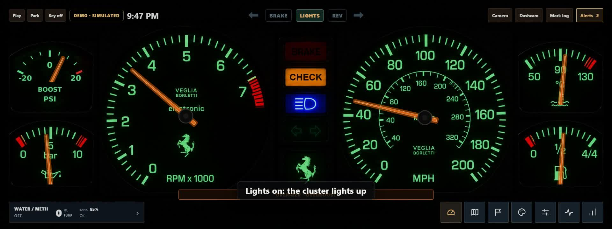
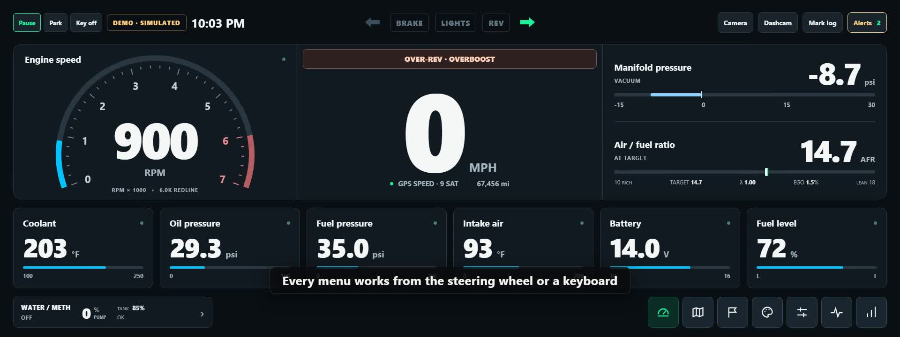
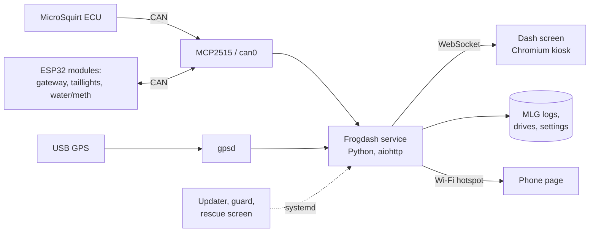

<div align="center">

# Frogdash

**A full digital instrument cluster for a turbocharged Foxbody Mustang.**
Raspberry Pi, 12.3-inch 1920 × 720 display, live engine data over CAN.

[](https://github.com/averyizatt/frogdash/actions/workflows/test.yml)
[](https://averyizatt.github.io/frogdash/)


**[Try the live preview](https://averyizatt.github.io/frogdash/)** · [Documentation](docs/README.md) · [Install](#install)

</div>

| Looks and photo clusters (72 s) | Menus, shortcuts and features (1:45) |
|---|---|
| [](docs/media/frogdash-tour.mp4) | [](docs/media/frogdash-features.mp4) |

<sub>Recorded from the simulated preview: the readings are demo data. Click a picture to play the video.</sub>

## What it is

Frogdash replaces the gauge cluster of a 2.3 L turbo Foxbody with a wide screen that shows
what the engine is doing, warns before something breaks, records every drive and runs the
car's own add-ons: water/methanol injection, knock monitoring, custom taillights and
interior lighting. It reads the MicroSquirt ECU and the car's modules over CAN, GPS through
`gpsd`, and runs entirely on the Pi: no cloud, no phone app, no internet needed to drive.

It is built to live in a car. It starts in seconds, survives the key going off mid-write,
updates itself from GitHub with a trial start and automatic rollback, and can be set up,
diagnosed and recovered from the screen, the steering wheel or a phone, without SSH.

## Features

### Gauges and looks
- **Live instruments:** tachometer, GPS speed, boost/vacuum, AFR against the ECU's target,
  coolant, oil and fuel pressure, intake air, battery and fuel level, each with its own
  live / stale / fault / no-signal state so a dead sensor never looks like a reading.
- **28 looks in five collections:** signature, track and touring, retro and future, cyber
  (neon HUD) and photo clusters, plus two dozen backgrounds, a colour studio, numeral
  typefaces, panel shapes, glow, transparency and your own images and splash screens.
- **Photo clusters:** real gauge faces (an old-school Ferrari, a yellow-tach Ferrari, a Fox
  LCD cluster, Saleen white faces) with needles measured to the printed marks and every dial
  wired to a real reading. Each has a day and a night picture: with the lights on, the
  cluster lights up and the needles glow.
- **Night lighting:** follows the running lights, with its own brightness and colour.
- **Street, Tuning and Track layouts** that keep their own gauge choices.
- [UI design](docs/ui-design.md) · [Race and appearance](docs/race-and-appearance.md)

### Alerts that say what went wrong
- **26 alerts** across oil, temperatures, boost, AFR, fuel, knock, ignition, electrics,
  water/meth, the car's modules and the Pi itself. Each has its own switch, threshold, delay
  and a plain explanation of what it watches and what to check.
- Shown on the dash (and on photo clusters as a CHECK lamp), with optional chimes through
  the screen's speakers, latched until acknowledged and saved in the drive's record.
- [Driving tools and alerts](docs/driving-tools.md) · [Screen audio](docs/screen-audio.md)

### Logging, review and tuning
- **MegaLogViewer logs:** genuine `.mlg` files at 20 Hz, rotated and kept within a budget,
  recording with the screen closed.
- **Drive review:** every drive with synchronised graphs, bookmarks (press **B**) and faults;
  live graphs of boost, RPM, mixture, knock and temperatures; a last-drive summary.
- **TunerStudio on the dash:** opens over the gauges with a keyboard and the tuning cable,
  installed from the Tune tab when wanted.
- **CAN tools:** a DBC file for SavvyCAN and cantools, raw CAN capture, live signal list.
- [Data logging](docs/data-logging.md) · [TunerStudio](docs/tunerstudio.md) ·
  [SavvyCAN and DBC](docs/savvycan.md)

### Engine and car controls
- **Water/methanol injection:** arm, pump test, progressive flow by boost, failsafes,
  presets and live injection status, from a controller on the CAN bus.
- **Knock monitor:** live knock energy, events, the sensor's spectrum with the listening
  band, amplifier gain and every setting.
- **Taillight studio:** shows, styles, colours, timing and profiles for custom LED
  taillights, with a recorded mirror of the LEDs on screen.
- **Interior lights, Wi-Fi and the phone hotspot** under Controls.
- **Module firmware over CAN:** new builds for the car's ESP32 modules arrive with an update
  and install from the dash.
- [Controls](docs/controls.md) · [Water/meth](docs/water-meth.md) · [Knock](docs/knock.md) ·
  [Taillights](docs/taillights.md) · [Firmware updates](docs/firmware-updates.md)

### Driving
- **Trips and fuel economy:** Trip A/B, MPG and range from calibrated injector data.
- **Offline street map** centred on the GPS, heading up or north up.
- **Race timer:** 0–60, eighth and quarter mile, automatic or manual GPS laps, saved sessions.
- **Cameras:** a Pi CSI reverse camera with guide lines, and a Wi-Fi dash cam's live front
  and rear view.
- [Trips and fuel](docs/trip-and-fuel.md) · [Map](docs/map.md) ·
  [Reverse camera](docs/reverse-camera.md) · [Dash cam](docs/dashcam.md)

### Phone and Wi-Fi
- With the engine off, the Pi's Wi-Fi is yours: download logs, see faults, run the system
  check and update the dash from a phone page, signed in with a code shown on the dash.
- Diagnostics and the newest drive upload to GitHub after each update.
- [Wi-Fi access](docs/wifi-access.md) · [Log uploads](docs/log-uploads.md)

### Built to keep running
- **Updates from the dash:** each new version is started on the side before it is used,
  checked after the restart, and undone automatically if it does not come up. Cancel is
  always there, and a run cut off by the key going off never leaves the screen stuck.
- **Recovery without a keyboard:** a watchdog, a guard that puts back the last version that
  ran, and a rescue screen with what can be done.
- **Power:** a PiSugar 3 Plus rides through the key going off and shuts Linux down cleanly.
- **Setup without SSH:** everything the Pi needs is a step the updater runs by itself, shown
  with its result under Sensors → System check.
- [Reliability](docs/reliability.md) · [Power](docs/pisugar-power.md) ·
  [Setup and service](docs/ownership-and-service.md) · [Boot and kiosk](docs/boot-and-kiosk.md)

## Controls and shortcuts

Everything works from five steering-wheel buttons, a touch screen or a keyboard.

| Wheel | Key | Does |
|---|---|---|
| Up / Down / Left / Right | Arrow keys (or W / S / D) | Move between items and tabs |
| ON | Enter, E or Space | Select; edit a value |
| Hold ON (0.8 s) | Hold Enter | Quick dock with every destination |
| OFF | A or Esc | Back |
| Hold OFF (1.5 s) / hold ON (3 s) | Hold A | Close every menu |
| | M | Controls |
| | K | Knock monitor |
| | B | Bookmark this moment in the log |

[Steering-wheel navigation](docs/steering-wheel.md)

## Hardware

| Part | Used for |
|---|---|
| Raspberry Pi 4 | Runs the service and the screen (Raspberry Pi OS, Chromium kiosk under Cage) |
| 12.3-inch 1920 × 720 bar display | The cluster; other screen sizes get responsive layouts |
| Waveshare RS485 CAN HAT | MCP2515 (12 MHz) + 3.3 V transceiver: `can0` at 500 kbit/s through SocketCAN |
| MicroSquirt ECU | Engine data, broadcast over CAN |
| ESP32 modules | Gateway, taillights and water/meth controllers on the same bus |
| VK-162 USB GPS | Speed, position, lap timing and the clock (through `gpsd` and chrony) |
| PiSugar 3 Plus | Battery ride-through and clean shutdown on ignition loss |
| Optional | Pi CSI reverse camera, Wi-Fi dash cam, USB keyboard for TunerStudio |

[CAN installation](docs/can-integration.md) · [MCP2515 wiring](docs/mcp2515.md) ·
[CAN compatibility](docs/can-compatibility.md) · [Fuel level over CAN](docs/fuel-can.md)

## How it fits together



The service decodes CAN and GPS, runs alerts, logging and race timing, and sends one
snapshot to the screen many times a second; the screen draws it. Commands (pump tests,
lighting, firmware) go back over CAN with acknowledgements. Root-only jobs (updates, Wi-Fi,
CAN resets) are separate systemd units that the service asks for through request files.

## Install

Flash **Raspberry Pi OS Lite (64-bit)** with Raspberry Pi Imager, then on the Pi:

```sh
curl -fsSL https://raw.githubusercontent.com/averyizatt/frogdash/main/tools/frogdash_install.sh | sudo sh
sudo reboot
```

One script installs everything (packages, the CAN overlay, the dash, its services, the
screen, GPS, the hotspot and recovery) and checks each part:
[fresh install guide](docs/fresh-install.md). From then on, **Dash management → Software &
power → Update now** keeps the Pi up to date. Wiring: [MCP2515](docs/mcp2515.md) and
[CAN + USB GPS](docs/can-integration.md).

## Try it without a car

The [live preview](https://averyizatt.github.io/frogdash/) is the production dashboard with
a simulated drive in place of the car: open it in any browser, or open
[`preview/index.html`](preview/index.html) from disk. Everything is clickable; the
**DEMO · SIMULATED** badge marks generated readings.

## Develop

```bash
python -m pip install -r requirements.txt -r requirements-tools.lock
python -m unittest discover -s tests          # About 440 tests
python tools/update_preview.py                # After editing hardware/ui/
python tools/update_preview.py --check

# Browser tests (Playwright)
python -m pip install -r requirements-browser.lock
python -m playwright install chromium
python tests/browser_smoke.py                 # Also browser_skins.py, browser_layout.py, ...
```

CI runs the Python tests on 3.11 and 3.13, pyflakes, the firmware contract build and the
preview check, and deploys `preview/` to GitHub Pages.

| Path | Contents |
|---|---|
| `hardware/frogdash/` | The service: CAN and GPS, alerts, logging, race timing, updates |
| `hardware/ui/` | The dashboard (HTML, CSS, JavaScript) and the photo cluster pictures |
| `hardware/transfer/` | The phone page |
| `hardware/systemd/` | Service, path and timer units |
| `hardware/can_contract/` | The CAN contract shared with the module firmware, and the DBC |
| `hardware/power/` | PiSugar monitor and shutdown hook |
| `tools/` | Updater, setup, guard, rescue screen, uploads and helpers |
| `preview/` | The simulated preview (generated from `hardware/ui/`) |
| `tests/` | Unit, script and browser tests |
| `docs/` | Installation, hardware and feature guides |

## Status

Version 0.4.0. Running in the car, with diagnostics uploaded after each update; desktop
and browser tests cover every feature. See the [documentation](docs/README.md) for what each
part does and how it was checked.
